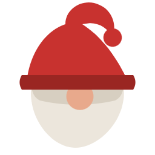
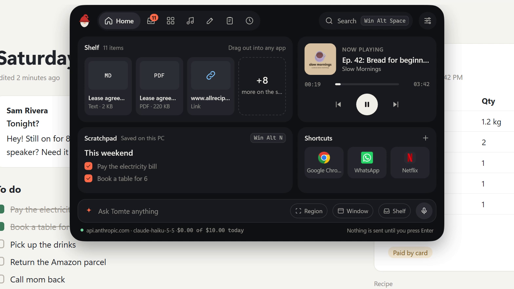
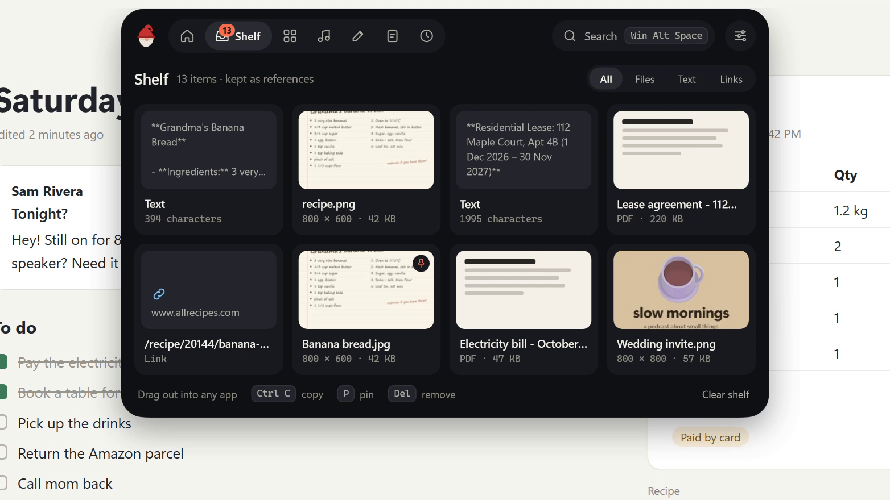
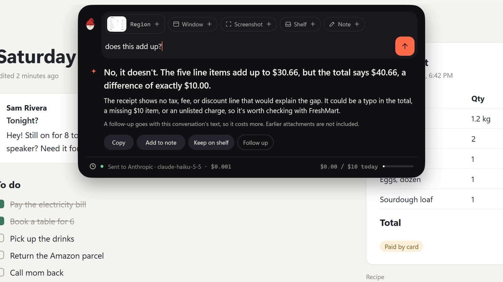
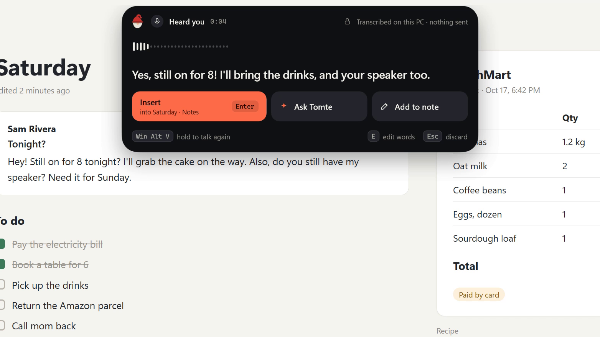
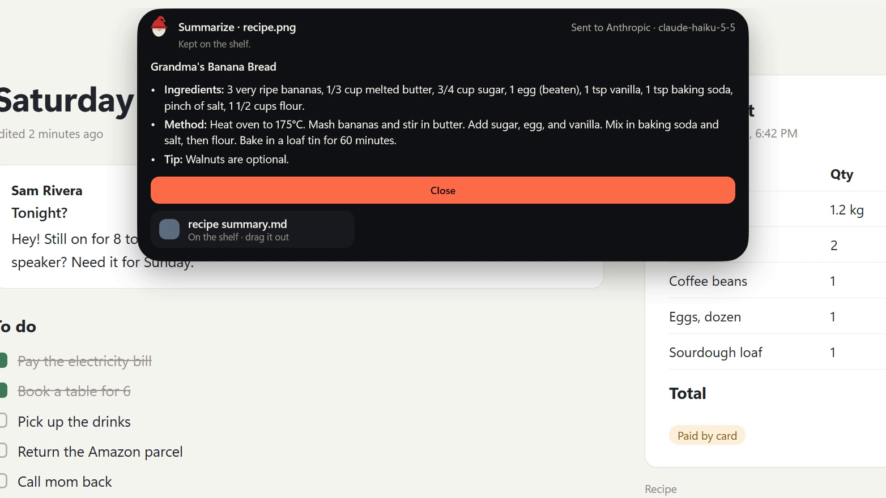
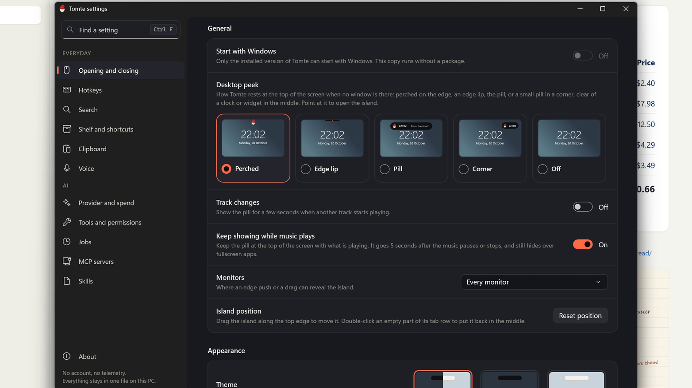

<p align="center">
  
</p>

<h1 align="center">Tomte</h1>

<p align="center">
  A small Windows 11 app that lives in the top edge of your screen.<br>
  <a href="https://tomte.xditya.me"><b>Website</b></a> · <a href="https://apps.microsoft.com/detail/9PG849MLVWZC"><b>Download</b></a> · <a href="#build-from-source">Build from source</a> · <a href="#support">Support</a>
</p>

<p align="center">
  
</p>

When you're not using it, Tomte draws nothing, takes no screen space and never steals focus. Push the pointer against
the top edge, press a hotkey or drag a file up there, and it opens. Everything before the AI section works with no
account and no key.

## What's in it

- **Home.** Your shelf, what's playing, your note, your shortcuts and an Ask bar on one page.
- **Shelf.** Park files, text and links while you work, then drag them out into any app. Pin the ones you want to
  keep there after you drag them out, and filter by files, text or links.
- **Shortcuts.** Tiles for apps, folders, web pages and scripts.
- **Media.** Play, pause, skip and seek whatever is playing, in any app that shows up in Windows' media controls.
- **Scratchpad.** One Markdown note, <kbd>Win</kbd>+<kbd>Alt</kbd>+<kbd>N</kbd> away. It shows formatted, and you
  can tick its checklists without editing.
- **Clipboard history.** The last 50 bits of text and 50 images you copied, with a preview, a filter and pins.
  Anything a password manager marks as private is never kept.
- **Search.** <kbd>Win</kbd>+<kbd>Alt</kbd>+<kbd>Space</kbd> finds apps, files and Windows settings pages. It uses
  [Everything](https://www.voidtools.com/) when that's running, and the Windows index when it isn't.
- **Timers** that count down in the pill, and an optional pill that shows the song while music plays.



It hides over fullscreen apps, games and the lock screen. On an empty desktop a small tomte can sit on the top edge
(or an edge tab, the pill, or a corner pill, or nothing), and the island follows your taskbar's light or dark theme.

## AI, if you want it

Add your own key for Anthropic, Gemini or any OpenAI-compatible server, including a local Ollama. Nothing is sent
until you send it, and every answer says which model got it and what it cost.

**Circle to ask.** Press <kbd>Win</kbd>+<kbd>Alt</kbd>+<kbd>C</kbd>, draw around anything on screen and ask about it.



**Voice.** Hold <kbd>Win</kbd>+<kbd>Alt</kbd>+<kbd>V</kbd>, talk, let go. Insert types the words where you were
typing, and <kbd>E</kbd> lets you fix the words first. Speech becomes text on your PC with whisper.cpp, so this part
needs no AI at all.



**Drop zones.** Drag a file to the top edge and hold it there for a moment, then drop it on Summarize, Ask, Tables to
CSV or Rename. The result lands on the shelf. Dropping it straight away just puts it on the shelf.



It can also read PDF and Word files, change settings like dark mode or volume (it asks before each one), use MCP
servers and Agent Skills, and run jobs on a schedule you confirm. Closed an answer by mistake?
<kbd>Win</kbd>+<kbd>Alt</kbd>+<kbd>Z</kbd> brings it back for 10 seconds, without sending it again.

## Settings



Every setting has a page, and <kbd>Ctrl</kbd>+<kbd>F</kbd> finds one by name or by what it does. Choices like how
Tomte rests on the desktop, its theme and its accent colour show a picture of each option.

## Keyboard

| Hotkey | Opens |
|---|---|
| <kbd>Win</kbd>+<kbd>Alt</kbd>+<kbd>I</kbd> | Home and the panels |
| <kbd>Win</kbd>+<kbd>Alt</kbd>+<kbd>Space</kbd> | Search |
| <kbd>Win</kbd>+<kbd>Alt</kbd>+<kbd>A</kbd> | The AI box |
| <kbd>Win</kbd>+<kbd>Alt</kbd>+<kbd>C</kbd> | Circle to ask |
| <kbd>Win</kbd>+<kbd>Alt</kbd>+<kbd>V</kbd> (hold) | Voice |
| <kbd>Win</kbd>+<kbd>Alt</kbd>+<kbd>N</kbd> | Scratchpad |

All of them can be changed in Settings. <kbd>Esc</kbd> closes whatever is open.

## Privacy

- No account, no telemetry, no update check.
- Your shelf, note, clipboard and AI history stay in one SQLite file in `%LOCALAPPDATA%\Tomte`. Keys are kept in
  Windows Credential Manager.
- Nothing goes to an AI provider until you send it.

The full [privacy policy](https://tomte.xditya.me/privacy) lists what is stored and what is sent.

## Install

Needs Windows 11 22H2 or later on x64.

<a href="https://apps.microsoft.com/detail/9PG849MLVWZC"></a>

Or from the command line, the same Store build:

```powershell
winget install 9PG849MLVWZC
```

Tomte starts hidden, with an icon in the notification area. The [releases page](https://tomte.xditya.me/releases) also
has the `.msix` from GitHub, which isn't signed yet.

## Build from source

Needs the .NET 10 SDK.

```powershell
git clone https://github.com/xditya/tomte-windows.git
cd tomte-windows
dotnet build Tomte.sln
dotnet run --project src/Tomte.Shell
dotnet test Tomte.sln
```

## Support

Tomte is free and open source. If you'd like to help keep it going:

- [GitHub Sponsors](https://github.com/sponsors/xditya)
- [Buy Me a Coffee](https://buymeacoffee.com/xditya)
- [Ko-fi](https://ko-fi.com/xditya)
- UPI: `botzhub@ybl`
- USDT on BNB Smart Chain (BEP20): `0xc8cbfa55be28b0836a4ab830ea85c64516dffaf3`
- USDT on Tron (TRC20): `THDKzV4ZKeDBsrFRSbL5XZgqVQUEkPfWcW`

Send USDT only on the network named next to its address.

## License

[MIT](LICENSE)
